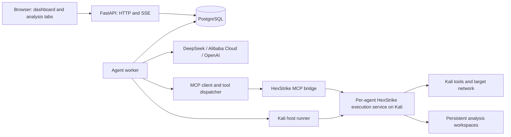

# CTF AI Harness — implementation plan

Status: Phase 0 local integration tooling implemented and verified on 2026-11-01, including Docker-to-host HTTP through Linux host networking. Provider protocol fixtures pass; live compatibility is assumed per user instruction until tokens exist. CTF/VPN callback verification remains pending under the local-only assessment scope; Docker Compose is not installed. Phases 1–12 are not started. See [integration findings](docs/integration-findings.md).

## 1. Product requirements

- Browser UI with a polished dark theme, running on the Kali VM through Docker Compose.
- An analysis contributes to solving a CTF box: recon, investigating a service, exploitation, or obtaining challenge tokens. A recon task can complete without solving the entire box.
- Unlimited analyses; each analysis may have at most five subagents. There is no global five-analysis limit.
- Users interact with running agents through configured tool approvals only. Results can be used to create a subsequent analysis.
- Persist settings, provider connections, agent presets, approvers, analyses, results, tool history, approvals, and workspace artifacts across application restarts and VM reboots.
- Support DeepSeek, Alibaba Cloud Model Studio, and OpenAI.
- Use HexStrike MCP to execute Kali tools on the VM host. Allow additional MCP servers later, including Bash execution.
- Allow tools to be globally blacklisted and individually selected in presets, grouped as Recon, Depth, and Universal.
- Give every analysis a randomly named working directory, with separate directories for its main agent and subagents.
- Target tokens are located on the remote CTF box at `/home/<vulnerable user>/Desktop/token.txt` and `/root/Desktop/token.txt`. The objective is their content, not simply locating the files.
- When an analysis obtains tokens, include their contents in the last sentence of the final response.
- Preserve the requested dashboard behavior: compact running previews and subagent extensions collapse on completion; Details opens the full analysis in a new browser tab.

## 2. Proposed technical decisions

These are implementation defaults, not additional user requirements.

| Area | Choice | Reason / alternative |
| --- | --- | --- |
| Frontend | React, TypeScript, Vite | Browser application with a static production build; server rendering is unnecessary for this dashboard. |
| UI | Tailwind CSS, shadcn/ui, Lucide icons | Customizable dialogs, forms, cards, sidebars, and consistent dark styling. Deliberate layout and typography still need design work. |
| Routing and API state | React Router, TanStack Query | Linkable analysis routes, cache invalidation, and reconnect handling. |
| Backend | Python, FastAPI, Pydantic | Typed APIs and convenient integration with Python MCP tooling. |
| Persistence | PostgreSQL, SQLAlchemy, Alembic | Shared durable state for API and worker processes, transactional approvals and task claims. SQLite WAL remains a valid smaller deployment alternative. |
| Agent execution | Separate Python worker with an explicit persisted agent state machine | Keeps model/tool execution independent of browser connections and HTTP request lifetimes. |
| Model integration | Small provider adapters using official SDK/API interfaces | Preserve provider-specific tool calls and continuation data. Consider LiteLLM later if adapter maintenance warrants it. |
| MCP | Official Python MCP SDK, with a tool registry and dispatch layer | One integration path for HexStrike and future MCP servers. |
| Browser updates | Application SSE stream plus HTTP commands | Status/log updates travel server to browser; approvals and configuration use HTTP. This is separate from MCP transport. |
| Execution on Kali | Small host runner service managing per-agent HexStrike execution processes | Container working directories do not determine the working directory of host-executed tools. |
| Deployment | Docker Compose for web/API, worker, and database; host runner installed on Kali | Keeps existing host tools and target-network access available. |
| Artifacts | Host bind-mounted workspace tree; SQL records reference files | Keep large outputs and downloaded/generated files out of normal database rows. |
| Verification | pytest, frontend typecheck/build, Playwright for critical flows | Focus tests on execution, approvals, recovery, and browser behavior. |

Use PostgreSQL as the durable task queue initially. Do not add Redis, Celery, Kubernetes, or a separate workflow platform without a concrete need.

## 3. Architecture and mechanics



### Execution boundaries

- The application and agent orchestration run in Docker. HexStrike execution and Kali tools run on the host.
- The host runner receives analysis/agent identifiers, creates directories, starts execution services, allocates endpoints, records process ownership, and handles cleanup.
- Baseline approach: one lazily started HexStrike execution service per active agent, launched with that agent's directory as its process working directory. Each MCP bridge is routed to the correct service endpoint. Use absolute script paths when launching outside the HexStrike install directory.
- Give these processes separate temporary directories and explicit output paths. Check tools that use absolute paths, shared caches, fixed filenames, ports, or sessions; a process working directory alone does not resolve those collisions.
- This separates execution context and outputs. The agents still share the Kali host and its resources.
- If per-agent HexStrike processes prove too expensive, evaluate a pinned HexStrike change that propagates request-local working directories through every relevant execution and file path. Never use process-global `os.chdir()` in a shared concurrent service.
- Never treat changing the MCP bridge's working directory inside Docker as a solution for host-side execution context.
- Resolve Docker-to-host routing explicitly. Container `127.0.0.1` is normally the container itself; document bridge/host-gateway addressing, host binds, and callback routing. Linux host networking is an alternative deployment option.

### Workspace layout

```text
/srv/ctf-harness/workspaces/<random-analysis-id>/
  main/
    artifacts/
    tmp/
  subagents/<random-agent-id>/
    artifacts/
    tmp/
  shared/
  exports/
```

- Generate identifiers server-side with UUIDs or equivalent random identifiers; store the paths in SQL.
- Use the same absolute workspace path in the host runner and relevant bind mounts.
- Each agent receives its own working path and the analysis shared path as execution context.
- Share artifacts deliberately through `shared/`; avoid implicit cross-agent file overwrites.
- Keep completed workspaces until the user explicitly deletes their artifacts.

### Run lifecycle

1. Save an analysis as Draft.
2. Start creates an execution attempt and durable queued task.
3. A worker claims the task transactionally and creates the main agent's execution context.
4. The provider receives the task, preset instructions, selected prior results, workspace information, and available tool definitions.
5. Each requested tool call is persisted and validated against the current tool configuration.
6. Manual approval waits for the user; Assisted asks the configured approver; Full auto dispatches immediately.
7. Approved calls execute through MCP. Persist results and notify browsers, then continue the provider conversation.
8. Subagents follow the same lifecycle and return results to the parent.
9. Completion persists the final report, token evidence, outcome, and timing before collapsing dashboard previews.

### Concurrency and completion defaults

- No application-level cap on the number of analyses users can create or start.
- Interpret five subagents as at most five children created per execution attempt. Initially use one level of subagents; child agents do not create grandchildren. Keep this choice explicit and adjustable if the user wants five concurrent children instead.
- Use configurable provider-request and host-tool resource limits to manage actual capacity. These are operational controls, not a hidden five-analysis limit; show queued activity when capacity is unavailable.
- Waiting on approval, subagents, or provider backoff must not occupy a scarce execution slot.
- Give approver requests a separate execution lane so agents waiting for approval cannot block their own approvers.
- An analysis completes when its assigned contribution is finished, or when it concludes the box is solved. Track `task_completed`, `tokens_found`, and `box_solved` separately.
- When concluding the box is solved, stop scheduling further work, settle/cancel child activity, and finalize the report. Preserve partial outputs.

## 4. Ordered implementation backlog

### Phase 0 — prove host execution and provider compatibility

Dependencies: none. Resolve these integration risks before building the full application.

- [x] Record the installed Kali, Docker, HexStrike, Python, and MCP versions; pin the HexStrike revision and application dependencies used by the project. — Recorded installed versions, exact source hashes, MCP dependency lock, and the observed HexStrike environment. Docker client/engine 28.5.2+dfsg4 became available during the assessment; Compose remains absent.
- [x] Inspect the actual installed HexStrike MCP transport and execution interfaces. Upstream has a bridge plus HTTP execution service; do not assume the HTTP execution API is itself an MCP endpoint. — Verified real stdio MCP initialization and forwarding to HTTP on port **8888**.
- [x] Discover the tool catalog and verify a small representative set of installed tools actually works. — Discovered 150 MCP tools; tested local strings/xxd/file operations, shell execution, and `nmap --version` without scanning targets.
- [x] Check existing arbitrary-command support. Upstream already exposes `execute_command`; treat another Bash MCP as optional rather than required for initial shell capability. — Verified through the installed bridge.
- [x] Prototype two host-side execution contexts simultaneously. Run commands with identical relative output filenames and verify outputs land in different directories. — Overlapping real MCP calls produced independent relative outputs and child-generated files.
- [x] Verify temporary paths, generated files, cached results, tool-created subprocesses, and process ownership in those contexts. — Local fixtures passed with the pinned compatibility launcher; remaining tool-specific path/session limitations are documented.
- [x] Check which MCP calls return output only at completion and which expose genuine incremental output. Record capabilities; do not promise streaming stdout for a buffered tool. — Tested calls are buffered; timed command emitted zero MCP progress notifications. Host logs are separate from MCP stdout delivery.
- [x] Measure startup time and memory for a main agent plus five lazy HexStrike execution services; use the measurements to confirm the per-agent process design. — Six services: 3.172–3.577 seconds startup each, 918.01 MiB aggregate RSS / 742.36 MiB PSS at idle. Retain lazy per-agent services provisionally; workload/bridge overhead remains additional.
- [x] Confirm the local container-to-host connection. — **Docker-to-host HTTP passed** with Linux host networking, using a temporary image built from installed Python files and removed afterward. Docker client/engine availability was rechecked after the user's update: 28.5.2+dfsg4, accessible through noninteractive sudo. Compose remains unavailable. No remote machine or registry was contacted.
- [ ] Confirm the connection works with the VM's CTF/VPN networking and callback addresses. — No active VPN interface or callback route was available; that portion remains unverified under the local-only assessment scope.
- [ ] Confirm basic model tool-call round trips with each provider using a harmless local test tool. Do not select fixed model IDs until their account availability is known. — All three prototypes and offline tool-call fixtures pass. **Live compatibility assumed per user instruction**; credential-backed confirmation deferred, with no fixed live model IDs or provider API requests.
- [x] Record Alibaba Cloud region, workspace, endpoint, and matching API-key requirements in deployment configuration. — Added explicit deployment environment fields and matching-region/workspace/key guidance; account-specific values remain configurable.
- [x] Write the measured results and any required HexStrike compatibility changes into `docs/integration-findings.md`. — Includes measured results, source pins, raw evidence, commands, compatibility changes, and outstanding verification.

Acceptance: two concurrent execution contexts produce independent files, and all three provider adapters can complete a tool-call round trip. Any missing live credentials are recorded explicitly; mocked checks do not count as live verification.

Current acceptance: concurrent local execution and Docker-to-host HTTP passed; provider protocol fixtures passed, with live account compatibility assumed at the user's request. Original live-provider confirmation and CTF/VPN callback checks remain explicitly unverified. All assessment execution was local.

### Phase 1 — repository, development environment, and UI foundation

Dependencies: Phase 0 architecture findings.

- [ ] Create `frontend/`, `backend/`, `host-runner/`, `deploy/`, `docs/`, and test directories.
- [ ] Scaffold React/TypeScript/Vite and Python application packages with lockfiles and reproducible build commands.
- [ ] Add linting, TypeScript checks, Python checks, and CI commands.
- [ ] Define a cohesive dark design system: background/surface levels, typography, spacing, status colors, focus states, motion, and the green primary action.
- [ ] Build the app shell with dashboard content and a right-side approval queue; provide a collapsible drawer at narrow widths.
- [ ] Define routes: `/` for the dashboard and `/analyses/:analysisId` for the analysis workspace.
- [ ] Implement reusable analysis cards, status badges, console previews, expandable output, empty states, and loading/error states using fixture data.
- [ ] Configure production static-file serving and route fallback so a direct analysis URL loads after a refresh.

Acceptance: the UI skeleton builds, has a consistent visual design, and supports direct navigation to an analysis route.

### Phase 2 — persistence model and migrations

Dependencies: Phase 1.

- [ ] Add PostgreSQL, SQLAlchemy models, and Alembic migrations.
- [ ] Create `provider_connections`: provider type, endpoint, region/workspace metadata, model catalog metadata, and credential reference.
- [ ] Create `agent_presets`: name, editable initial prompt, provider/model, supported reasoning settings, subagent switch/preset, tool selections, approval mode, and approver reference.
- [ ] Create `approvers`: name, editable initial prompt, provider/model, and supported reasoning settings.
- [ ] Create `analyses`: name, target name/IP, task additions, preset reference, draft fields, current status, workspace, optional source analysis, and timestamps.
- [ ] Create `execution_attempts`: analysis, attempt number, lifecycle, final report, task/box outcome, start/end times, and interruption reason.
- [ ] Create `agents`: attempt, parent, directive, main/subagent role, workspace, lifecycle, and continuation checkpoint.
- [ ] Create `messages` and provider continuation storage: canonical conversation records plus provider-specific fields required for subsequent requests.
- [ ] Create `tool_servers` and `tool_catalog`: namespaced identity, schema, category, availability, global block state, and last discovery time.
- [ ] Create `tool_calls`: agent, provider call ID, requested/effective arguments, execution state, timestamps, runner job ID, output references, and error details.
- [ ] Create `approvals`: tool call, pending/approved/denied state, human/AI decision, explanation, approver reference, and timestamps.
- [ ] Create `tasks`: task type, claim lease, owner, heartbeat, retry information, and next eligible execution time.
- [ ] Create ordered `events` for replayable browser updates; include analysis, attempt, agent, tool call, timestamp, and payload.
- [ ] Create `artifacts` and `token_evidence`: workspace paths, target/source paths, exact observed token content, and supporting tool-call references.
- [ ] Add indexes for dashboard ordering, pending approvals, unclaimed tasks, event replay, and per-agent tool history.
- [ ] Persist settings and credential configuration; keep API keys out of client responses and normal logs. Document backup/restore of any credential encryption key.
- [ ] Avoid preset-version management UI. Keep only the execution metadata needed to display and continue an already-started attempt.

Acceptance: migrations work on an empty database, and representative settings, drafts, outputs, and approvals survive database/application restart.

### Phase 3 — application APIs and configuration panels

Dependencies: Phase 2.

- [ ] Implement provider connection save/edit/test endpoints and model selection with a manual model-ID fallback.
- [ ] Implement agent-preset and approver list/create/read/update endpoints with useful validation errors.
- [ ] Provide editable default prompts for agents and approvers; explain the appended analysis task separately in the UI.
- [ ] Implement analysis save/edit/list/detail APIs and transactional, idempotent Start requests.
- [ ] Reject editing an active execution in place; allow editing a draft or creating a follow-up draft from previous results.
- [ ] Separate analysis configuration from execution attempts so a retry preserves earlier tool history and reports.
- [ ] Implement preset and approver overlays with conditional reasoning, subagent, and approval controls.
- [ ] Implement New Analysis overlay with target/name, preset, additional task instructions, Save draft, and Discard confirmation when changed.
- [ ] Implement provider-specific capability metadata so unsupported reasoning options are disabled or omitted rather than sent blindly.

Acceptance: users can configure providers, approvers, and presets, then create/edit a draft and request a start.

### Phase 4 — MCP registry, discovery, and blacklist

Dependencies: Phases 0 and 2.

- [ ] Implement server registration and MCP connection lifecycle; support HexStrike's verified transport first and an extension point for other supported transports.
- [ ] Discover tools through MCP and persist their schemas with namespaced identities such as `hexstrike:nmap_scan`.
- [ ] Add a searchable tool-settings view with category assignment, global enabled/blocked state, and an optional note explaining a broken/useless tool.
- [ ] Make preset tool selection operate on individual tools; category selection is a UI convenience.
- [ ] Compute exposed tools as discovered/available tools intersected with preset selections, minus globally blocked tools.
- [ ] Enforce the same selection at dispatch time. Recheck pending approvals before execution so a newly blocked tool cannot run from an old request.
- [ ] Ensure duplicate tool names on different MCP servers cannot collide in model-facing names or logs.
- [ ] Preserve block/category choices across rediscovery; show removed tools as unavailable. Newly discovered tools remain unselected in existing presets.
- [ ] Map MCP input schemas to provider-supported function schemas without silently changing required tool arguments.
- [ ] Report disconnects, timeouts, malformed results, and missing executables as actionable errors.
- [ ] Document that a tool-name blacklist excludes MCP entry points; generic command execution can still invoke an underlying utility directly.

Acceptance: a blocked tool is absent from model requests and rejected at dispatch, including after rediscovery and while an old approval is pending.

### Phase 5 — Kali host runner and working directories

Dependencies: Phase 0 proof, Phase 2 identifiers, Phase 4 transport integration.

- [ ] Implement the host runner's create-context, start-service, status, execute-context metadata, stop-context, and cleanup interfaces.
- [ ] Allocate analysis and agent directories atomically and persist their host/container path mappings.
- [ ] Launch per-agent HexStrike services with explicit working directory, temporary directory, environment, log destination, and endpoint ownership.
- [ ] Route each MCP bridge to the matching HexStrike service; avoid a single accidentally shared execution endpoint.
- [ ] Add tool-specific output-path handling for tools that ignore the process working directory or default to shared paths.
- [ ] Return runner job IDs and actual process state so cancellation and recovery do not rely solely on a disconnected HTTP request.
- [ ] Associate process groups and background processes with their owning agent; collect partial output and terminate owned process trees when required.
- [ ] Track fixed-port/listener reservations separately from filesystem paths and show an actionable collision error.
- [ ] Disable or scope output caching for workspace-dependent commands and token evidence reads; a previous run's cached output must not be treated as a fresh observation.
- [ ] Add lazy startup, idle teardown, and resource measurements for execution services while retaining artifacts.
- [ ] Provide a systemd unit and installation instructions for the runner, including boot ordering and host directory ownership.
- [ ] Add an integration hook for future Bash MCP servers that receive the same per-agent execution context.

Acceptance: main agents and subagents write to their own directories; concurrent runs do not overwrite relative outputs; cleanup stops owned processes while preserving completed artifacts.

### Phase 6 — provider adapters and agent worker

Dependencies: Phases 2, 4, and 5.

- [ ] Define a provider interface for streaming model events, tool requests, final responses, usage, supported settings, and continuation state.
- [ ] Implement OpenAI using the Responses API and custom function calls executed by this harness. Preserve required response/reasoning items when continuing after tools.
- [ ] Implement DeepSeek with its documented tool-call interface. Preserve provider-specific continuation fields, including reasoning content when required by the chosen API/model.
- [ ] Implement Alibaba Cloud Model Studio with configurable endpoint/region and its documented compatible interface, including model-specific thinking/tool-call parameters.
- [ ] Keep HexStrike execution local to the harness; hosted providers receive tool definitions and results rather than needing direct network access to the VM's MCP services.
- [ ] Validate and assemble streamed tool arguments before creating an executable call; handle multiple calls and empty assistant content.
- [ ] Persist model turns and proposed calls before dispatch; store usage and distinguish provider errors from tool failures.
- [ ] Implement durable task claiming with leases/heartbeats and short transactions, not database locks held during external calls.
- [ ] Implement the agent state machine: queued, thinking, requesting tool, awaiting approval, executing tool, waiting for subagents, completed, failed, and interrupted.
- [ ] Keep analysis lifecycle separate from agent activity: one child awaiting approval does not mean all sibling agents have stopped.
- [ ] Add provider backoff/rate-limit handling and fair scheduling among analyses.
- [ ] Add configurable operational timeouts and optional turn/token/cost limits; do not hardcode an arbitrary global analysis cap.
- [ ] Preserve the complete tool transcript while bounding model context with explicit output excerpts, summaries, and artifact references.
- [ ] Render provider-supported activity summaries only; a Thinking indicator must not depend on access to hidden model reasoning.
- [ ] Implement finalization and Stop handling, including settled/cancelled children and partial results.

Acceptance: each provider completes a multi-step analysis with persisted tool history, and closing every browser tab does not stop execution.

### Phase 7 — durable manual and assisted approvals

Dependencies: Phase 6.

- [ ] Implement Manual, Assisted, and Full auto dispatch modes exactly as preset options.
- [ ] Persist approval items before showing them in the right sidebar; sort oldest first and display the pending count.
- [ ] Display analysis, agent, tool, proposed arguments, request time, and short action explanation; expand long arguments.
- [ ] Bind each decision to one immutable tool-call ID and argument set. Any changed arguments require a new request.
- [ ] Make Approve/Deny transactional and idempotent so two open browser tabs cannot execute the same request twice.
- [ ] In Assisted mode, send the approver the proposed tool, arguments, task, relevant execution context, and its editable risk/destructiveness prompt.
- [ ] Require a structured AI decision: approve/deny plus a concise explanation. The approver has no execution tools.
- [ ] Send malformed, unavailable, or timed-out approver decisions to the human approval queue with an explanation.
- [ ] Return a denial to the requesting agent as a tool result so it can choose another approach.
- [ ] Persist human and AI decisions in the tool history; keep pending approvals available after reboot.
- [ ] Prevent decisions on cancelled/superseded calls from dispatching work.

Acceptance: all modes work, double approval causes only one dispatch, and waiting approvals survive a worker restart.

### Phase 8 — subagent orchestration

Dependencies: Phases 6 and 7.

- [ ] Add harness-owned spawn/wait/result tools, separate from the external MCP catalog.
- [ ] Resolve the selected subagent preset and create a child with its directive, own transcript, working directory, and parent link.
- [ ] Enforce the five-child limit transactionally so simultaneous spawn requests cannot exceed it.
- [ ] Prevent recursive spawning in the first version; document that this is an implementation default.
- [ ] Apply the selected child preset's tools and approval mode, while respecting the global blacklist.
- [ ] Release scarce execution capacity while the parent waits; collect child findings and artifact references when ready.
- [ ] Handle child failure, denial, cancellation, and partial results without losing the parent's report.
- [ ] Stop remaining children when the parent finishes or is stopped; preserve all completed history.

Acceptance: six simultaneous spawn requests create at most five children; waiting parents do not deadlock children or approvers.

### Phase 9 — dashboard, live events, and detail tabs

Dependencies: Phases 3, 6, 7, and 8.

- [ ] Implement compact dashboard cards with target, task, preset, lifecycle status, elapsed time, activity, and child count.
- [ ] Show Draft cards with Edit and Start analysis; show started analyses with Details opening a new browser tab.
- [ ] Add a bounded console preview during execution, clearly labeled tool requests, tool execution/waiting, thinking, and approval activity.
- [ ] Add compact subagent extensions showing short directives and current activity.
- [ ] Collapse only verbose dashboard extensions on completion; preserve the card, status, summary, and Details action.
- [ ] Implement details with task, agent tree, final report, token outcomes, complete tool history, approval decisions, and artifacts.
- [ ] Truncate inputs and outputs independently in the UI; fetch/expand the stored content on demand and support downloading large raw output.
- [ ] Add history filtering by agent/tool and server-side search or pagination for large transcripts.
- [ ] Persist monotonically ordered application event IDs and replay from the last received ID after SSE reconnect.
- [ ] Use a shared application event connection per tab; reconcile cached state after reconnect and deduplicate replayed events.
- [ ] Broadcast state changes only after commit. Provide periodic keepalives and configure proxy buffering appropriately.
- [ ] Show genuine incremental tool output only where supported. Otherwise show the request/running state and completed output without simulated stdout.
- [ ] Add dashboard pagination/filtering so unlimited saved analyses do not require rendering all cards at once.
- [ ] Render tool output as text and disable raw HTML in generated Markdown.

Acceptance: multiple tabs stay consistent, refresh does not lose history, completion collapses previews only, and large output does not freeze the dashboard.

### Phase 10 — token evidence and follow-up analyses

Dependencies: Phases 6 and 9.

- [ ] Include target token locations in the agent context, clearly identified as remote target paths rather than Kali workspace files.
- [ ] Allow discovering the vulnerable username; do not assume it equals the target name or the Kali username.
- [ ] Store user/root token observations separately, preserving exact contents and their supporting tool-call/source-path references.
- [ ] Distinguish observed token evidence from model claims; avoid marking a box solved because a response merely names a token path.
- [ ] Produce a structured final result with summary, findings, artifacts, outcomes, and observed tokens.
- [ ] Render a deterministic final sentence containing all observed tokens. If none were obtained, say so without inventing token values.
- [ ] Let recon and other partial contributions complete successfully without requiring both tokens.
- [ ] Add Create follow-up analysis from results; prefill the same target and selected findings/artifact references into a new editable draft.
- [ ] Preserve predecessor links; include relevant prior artifacts explicitly rather than silently granting every run a shared working directory.

Acceptance: a two-token fixture preserves both contents and evidence; the final sentence contains them; a recon-only fixture completes without pretending the box is solved.

### Phase 11 — reboot recovery and deployment

Dependencies: durable execution from Phases 5–10.

- [ ] Configure persistent PostgreSQL storage and a host workspace bind mount; never rely on a container writable layer for retained data.
- [ ] Provide Dockerfiles, Compose services, health checks, restart policies, environment examples, and a documented first-start command.
- [ ] Run migrations once before compatible API/worker processes start; prevent competing migration runners.
- [ ] On startup, reconcile database tasks, expired worker leases, pending approvals, and jobs still known to the host runner.
- [ ] Resume at a persisted boundary when the previous tool outcome is known. If an external call may have run but its result is unknown, mark it Interrupted and expose an explicit recovery/retry action.
- [ ] Do not blindly replay an uncertain tool call; persisted queue IDs alone do not guarantee exactly-once effects on a remote target.
- [ ] Handle application restarts separately from VM reboots: a host process may survive the former, while prior live sessions cannot survive the latter.
- [ ] Keep completed results and pending decisions usable even if a provider or HexStrike is temporarily unavailable.
- [ ] Document database plus artifact backup/restore as one operation, including credentials/configuration dependencies.
- [ ] Default to browser access on the VM; make listen address configurable. Document authentication requirements if LAN access is enabled later.
- [ ] Document CTF/VPN routing, callback addresses, port conflicts, runner installation, logs, and updating pinned dependencies.

Acceptance: reboot the VM and verify retained drafts, settings, results, logs, artifacts, and approvals; interrupted work is accurately represented and no uncertain call executes twice automatically.

### Phase 12 — focused integration verification and first release

Dependencies: all earlier phases.

- [ ] Test dispatch-time blacklist enforcement and tool rediscovery persistence.
- [ ] Test workspace separation, identical filenames, process ownership, and partial-output retention.
- [ ] Test multi-step provider continuation, streamed argument assembly, unsupported reasoning settings, and provider backoff with recorded/mocked responses.
- [ ] Run credential-backed smoke checks for each configured provider and installed HexStrike tool subset; list unverified combinations explicitly.
- [ ] Test approval idempotency, cancellation races, restart persistence, AI denial, and approver outage fallback.
- [ ] Test five-subagent enforcement under concurrent spawn requests and parent/child completion behavior.
- [ ] Test crash windows before dispatch, during execution, and after execution but before recording a result.
- [ ] Use Playwright for draft creation, preset/approver editing, start, approval, Details new-tab navigation, completion collapse, output expansion, and follow-up creation.
- [ ] Verify terminal-like output cannot become executable browser markup and that large transcripts remain responsive.
- [ ] Run one end-to-end contribution against a competition test box with known token fixtures; verify final token content and persisted evidence.
- [ ] Finish operator documentation and record the exact tested deployment versions.

Acceptance: a documented first release can be installed on Kali, run several independent analyses, handle approvals and children, and retain evidence after reboot.

## 5. First useful delivery and dependency order

Deliver the smallest complete vertical slice before adding subagents and assisted approval:

1. Prove host execution context separation and provider round trips (Phase 0).
2. Establish the app, schema, draft/preset APIs, MCP filtering, and host runner (Phases 1–5).
3. Complete one main-agent analysis using one provider, Manual approval, full tool history, and a linkable detail page (parts of Phases 6, 7, and 9).
4. Verify saved results survive restart; then finish all three providers, Full auto, and Assisted mode.
5. Add subagents, token evidence, and follow-up analyses.
6. Complete VM-reboot reconciliation, deployment checks, and release validation.

Do not build the entire dashboard around simulated execution before proving the host integration. Do not hold the first usable release until every optional MCP server is supported.

## 6. Remaining choices and known gaps

- Exact provider model IDs and Alibaba Cloud endpoint/region are still configuration inputs; the plan does not assume an account-specific model is available.
- Folder-based separation is agreed. Shared host ports, remote sessions, and tool-specific caches still need explicit handling.
- Unlimited analyses means no product count limit; actual host memory/CPU, tool parallelism, and provider quotas are finite. Measure capacity and make operational scheduling visible.
- Five total children per attempt and one-level delegation are proposed defaults. If the intended rule is five concurrently active children with unlimited replacements, adjust the counter semantics before Phase 8.
- Details and approvals need real execution states; animated indicators must not imply unsupported live output or access to hidden reasoning.
- Preserve results after reboot as required. Seamless continuation of a live remote shell after a VM reboot is a separate capability and is not assumed.
- No preset versioning interface is planned. Configuration management should remain simple.

## 7. Primary references

Verify against pinned versions during implementation; these references informed the plan on 2026-11-01.

- [HexStrike MCP bridge source](https://github.com/0x4m4/hexstrike-ai/blob/master/hexstrike_mcp.py): tool definitions and bridge behavior.
- [HexStrike execution server source](https://github.com/0x4m4/hexstrike-ai/blob/master/hexstrike_server.py): subprocess, file, cache, and process behavior to verify in Phase 0.
- [Kali HexStrike package documentation](https://www.kali.org/tools/hexstrike-ai/): packaged entry points and server configuration.
- [OpenAI function calling](https://developers.openai.com/api/docs/guides/function-calling): Responses tool-call round trips and required continuation items.
- [DeepSeek thinking-mode tool calls](https://api-docs.deepseek.com/guides/thinking_mode/): provider-specific continuation requirements.
- [Alibaba Cloud function calling](https://www.alibabacloud.com/help/en/model-studio/qwen-function-calling) and [compatible interface](https://www.alibabacloud.com/help/en/model-studio/compatibility-of-openai-with-dashscope): tool calls, regional endpoints, and model-specific parameters.
- [FastAPI async guidance](https://fastapi.tiangolo.com/async/), [SQLAlchemy asyncio](https://docs.sqlalchemy.org/en/20/orm/extensions/asyncio.html), and [PostgreSQL task-claim locking primitives](https://www.postgresql.org/docs/current/sql-select.html).
- [Vite](https://vite.dev/guide/) and [shadcn/ui](https://ui.shadcn.com/docs): frontend foundation.
- [Application SSE](https://developer.mozilla.org/en-US/docs/Web/API/Server-sent_events/Using_server-sent_events): browser event delivery; application-level replay must be implemented by this project.
- [Docker volumes](https://docs.docker.com/engine/storage/volumes/) and [Linux host networking](https://docs.docker.com/engine/network/drivers/host/): persistence and networking deployment choices.
- [SQLite WAL](https://www.sqlite.org/wal.html): lighter database alternative and concurrency constraints.
